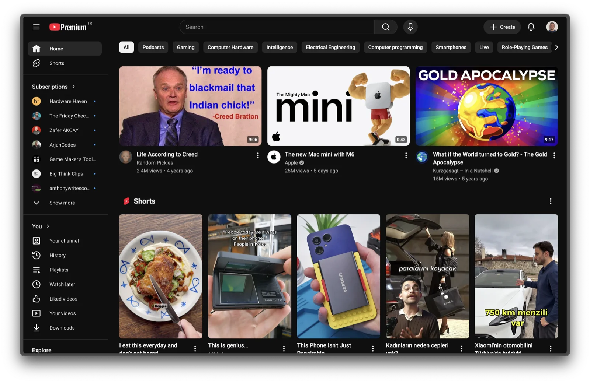
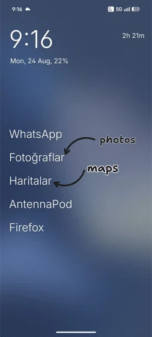
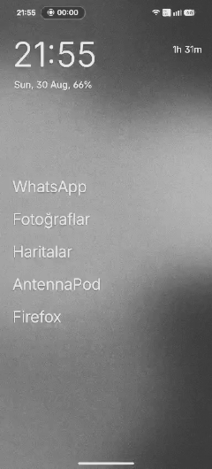
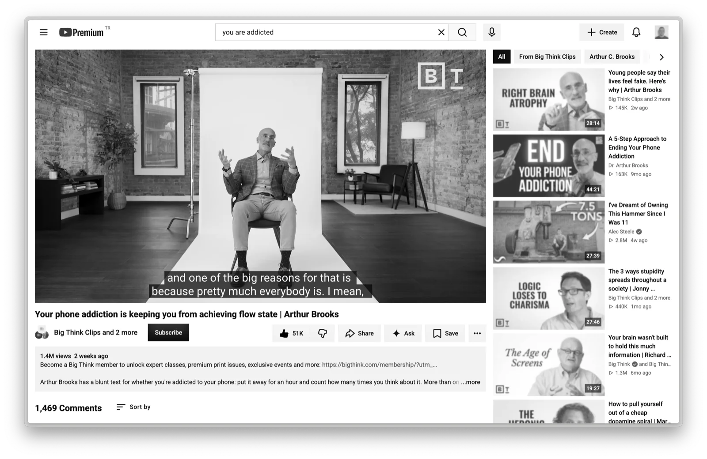

Everybody asks me why my phone is in grayscale. I tell them the story and show them my setup. At some point I got tired of repeating myself, so I wrote it down.

It starts with a failure. Once I overrode my own website blocker for 444 minutes. Not to check something important. Just to scroll. That day I accepted something I should have accepted much earlier: willpower cracks. Every time I relied on it, it eventually broke. So I stopped relying on self discipline and started building friction instead.

<figure class="captioned-figure">
  
  <figcaption>Maximum fun. The rest of this post is about making this boring.</figcaption>
</figure>

Trying to get my focus back is nothing new to me. Instagram, Facebook, TikTok: none of them ever had me. X on my phone is just a development news website. But staying away from those never solved anything, because my problem was never the apps. The traps are everywhere and they are intentional, built to be addictive, as [The Attention Merchants](https://www.goodreads.com/book/show/28503628-the-attention-merchants) describes well.

My problem is YouTube and Reddit, the two corners of the internet I can't cut ties with, because they are genuinely useful. On YouTube there are lots of incredibly beautiful and helpful videos: some about [things I like](https://www.youtube.com/watch?v=xbBdIG--b58) and watch occasionally, some about [my profession](https://youtu.be/ajSBGer05b8), and sometimes I show people old stupid videos I still laugh about to relate to the moment ([this one is in Turkish](https://www.youtube.com/watch?v=Y2szYwmNZkA), sorry). Reddit has genuinely good subreddits like r/LocalLLaMA and r/Python, and whenever I'm not satisfied with a Google result, I just add "reddit" to the end of the search. LinkedIn belongs in the same category: I lead a [community](https://pythonankara.com/), we organize events, and people without my contact info reach me there.

The things that drain me are the things I can't quit. So the plan was never to quit them. The plan was to make them boring.

## Make it harder

The first thing I tried was making things harder, which is [how you break a bad habit](https://jamesclear.com/atomic-habits-summary). I disabled the YouTube app on my Android phone and forced myself to use the browser. That alone didn't cut it, but YouTube's mobile browser experience is not great, so it already felt better than I expected.

Reddit got the rough treatment: I used the app for a while, then deleted it immediately. Too much noise, too much distraction. This was my first real lesson: no native applications for anything that resembles social media. The LinkedIn app got deleted too.

There are new devices like the [Minimal Phone](https://minimalcompany.com/) that claim to give your attention back to you. I haven't touched one yet, but I have been using [Olauncher](https://github.com/tanujnotes/olauncher) for more than a year and I'm happy with it. It is a distraction free, minimal launcher.

<figure class="captioned-figure">
  
  <figcaption>This is how my screen looks, by the way. This, but in grayscale. The screenshot just doesn't show it.</figcaption>
</figure>

## Blockers, and their limits

But none of that fully cut it. I could still roam around LinkedIn, Reddit and YouTube in the browser. If only there was a way to block them... There was.

[LeechBlock NG](https://addons.mozilla.org/en-US/firefox/addon/leechblock-ng/) lets you block websites whenever and however you like, and it is available on Firefox and Chrome(ium)s. So I blocked the top offenders on my computer: YouTube, LinkedIn, Reddit and Twitter/X. If I ever needed to look something important up, I could use the "Override" option to reach those websites for 5 minutes. And since good old [Firefox on Android](https://blog.mozilla.org/addons/2023/09/27/test-firefox-android-extensions-and-help-developers-prepare-for-an-open-mobile-ecosystem-in-december/) supports extensions too, I ran LeechBlock on my phone as well.

<figure class="captioned-figure">
  
  <figcaption>I open Firefox, search for reddit, and this happens. The original recording isn't in grayscale. I augmented it to match reality.</figcaption>
</figure>

So this solved everything, and the big bad wolf couldn't reach me. Except that the Override button got clicked more than it needed to be. That is where the 444 minutes happened.

## Grayscale

I have been using my phone in grayscale for more than two years now. The idea came from a video I can't find anymore, suggesting that you can put your phone in grayscale mode. It was the best thing I've ever tried. Making your phone grayscale takes the fun out of it. You don't like looking at your phone. You may not even understand things on it.

That's when it clicked. A blocker restricts access, and access can always be overridden. Grayscale kills appeal, and there is no override button for "this doesn't look fun anymore."

## Not interested

I use one more appeal killer, this time on the content itself. Whenever a platform has a "Not interested" button, I click it. Often, and whenever possible. Every click makes the feed a little more boring, which is exactly what I want. Because from time to time you click on something, and more of it rushes into your feed, stuff you end up consuming mindlessly. That click is not willpower, by the way. It costs nothing to reject something you already don't like.

At some point I changed my device and started using a Nothing Phone 3a. I kept the whole setup, except that instead of blocking everything I only blocked Reddit.

## The habit moves

For a long time I was happy with this. But increasingly I started using my computer more and more, and I felt a bit weird about it. I knew I had just transitioned my doomscrolling habit to the computer. I started wondering if my internet use was an addiction, but I didn't think it through until I stumbled upon this video, "[You are an Addict](https://www.youtube.com/watch?v=KHd-luu3M8s)".

So I accepted it: this was an addiction. Whenever I tried to just do nothing, my brain was craving the internet.

The problem was that I can't make my computer grayscale. There are things I need colors for, syntax highlighting for example. I hoped there was an [extension](https://addons.mozilla.org/en-US/firefox/addon/monochromate/) for it. There was. It was good, until I couldn't like everything about it. It is open source, so I [opened an issue](https://github.com/lirena00/monochromate/issues/62#issuecomment-5387562396) for it.

## Making the internet boring myself

Do I have to wait for a fix? No. There is a magically beautiful thing called Tampermonkey, with which you can write your own "userscripts" to _enhance the functionality of your favorite web pages_. In my case, to deliberately make them worse.

```javascript
// ==UserScript==
// @name         Minimalist Focus: Primal UI & 1px Blur
// @namespace    http://tampermonkey.net/
// @version      1.5
// @description  Grayscale, 1px blur on media, and brutalist UI (no rounded corners/shadows).
// @author       You
// @match        *://*.linkedin.com/*
// @match        *://*.reddit.com/*
// @match        *://*.x.com/*
// @match        *://*.twitter.com/*
// @match        *://*.youtube.com/*
// @grant        GM_addStyle
// @run-at       document-start
// ==/UserScript==

(function() {
    'use strict';

    GM_addStyle(`
        /* 1. PRIMAL UI (BRUTALISM) */
        * {
            border-radius: 0 !important;
            box-shadow: none !important;
            text-shadow: none !important;
        }

        /* UNCOMMENT BELOW to force a boring system font (might break some web icons) */
        /*
        body, p, h1, h2, h3, h4, h5, h6, a, span, button {
            font-family: "Courier New", Courier, monospace !important;
        }
        */

        /* 2. GRAYSCALE & TOP LAYER FIX */
        html, dialog[open], [popover]:popover-open, :fullscreen {
            filter: grayscale(100%) !important;
        }

        dialog[open]::backdrop, [popover]:popover-open::backdrop, :fullscreen::backdrop {
            backdrop-filter: grayscale(100%) !important;
        }

        /* 3. MEDIA BLUR */
        img, video:not(.active-media), iframe {
            filter: blur(1px) grayscale(100%) !important;
            opacity: 0.8 !important;
            transition: filter 0.2s ease, opacity 0.2s ease !important;
        }

        img:hover, video:hover, iframe:hover {
            filter: blur(0px) grayscale(100%) !important;
            opacity: 1 !important;
        }
    `);

    document.addEventListener('play', (event) => {
        if (event.target.tagName === 'VIDEO') {
            event.target.classList.add('active-media');
        }
    }, true);

    document.addEventListener('pause', (event) => {
        if (event.target.tagName === 'VIDEO') {
            event.target.classList.remove('active-media');
        }
    }, true);
})();
```

And since I wrote it myself, I went further. Squares instead of rounded buttons. No shadows, so everything looks flat. A 1px blur on anything that moves. Grayscale was the start; the script now strips the friendly UI right off.

<figure class="captioned-figure">
  
  <figcaption>Notice the rounded corners in this screenshot? I took those away too.</figcaption>
</figure>

Could I still escape all of this? Sure. Every layer here can be bypassed if I really want to. That's the point: the goal was never to make it impossible, just to make the default path slightly more annoying. And most of the time, when YouTube opens looking like a black and white photocopy of itself, half of me doesn't even want it anymore. Nothing here killed my addiction. Each layer just made it a little more expensive. Willpower cracks. Friction holds.

## TL;DR: what I do now

- No native apps for anything resembling social media; browser only.
- Olauncher as a minimal, distraction-free launcher.
- Phone is in grayscale. It takes the fun out of scrolling.
- I click "Not interested" on every media that offers the button; a boring feed is the goal.
- LeechBlock NG on my phone (Firefox for Android) blocks Reddit, the one site I still can't keep away from.
- My computer can't be fully grayscale (I need colors for code), so a small Tampermonkey userscript grayscales the distracting sites, blurs their media, and strips their friendly UI.
- I accepted that doomscrolling is an addiction, not a lack of discipline; the goal isn't willpower, it's friction.
