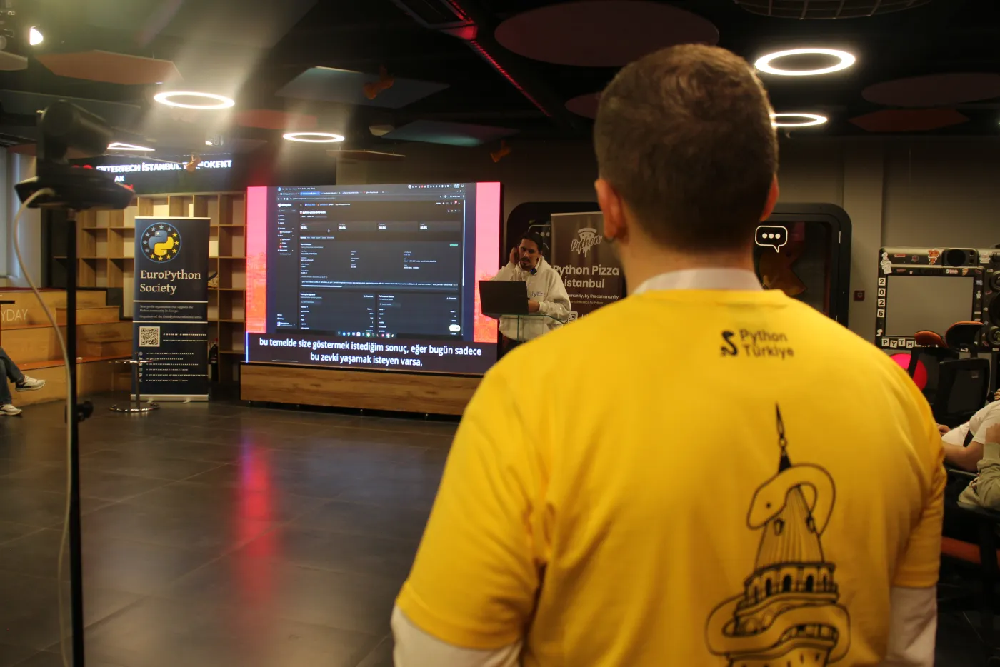
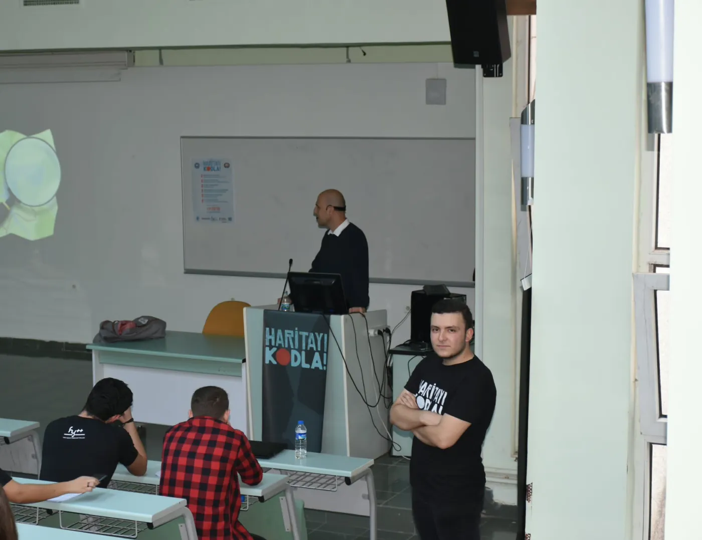
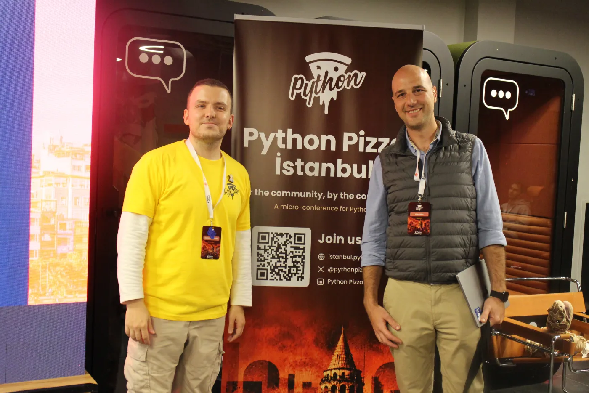
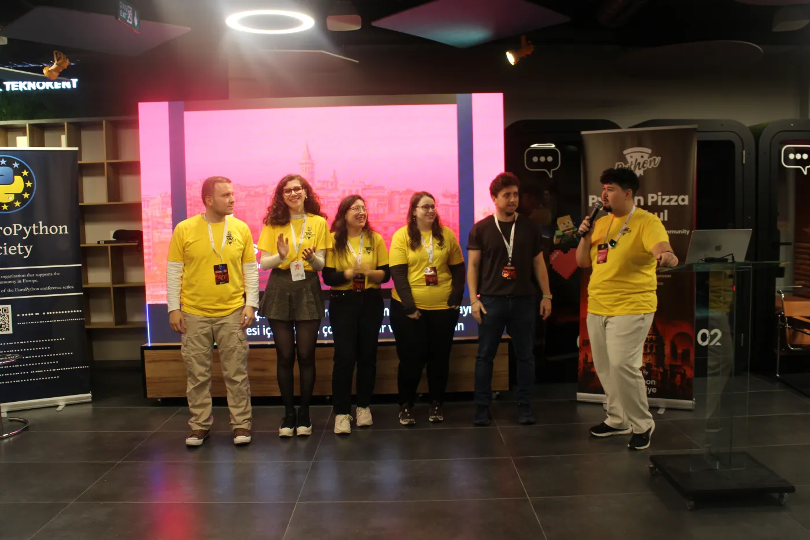
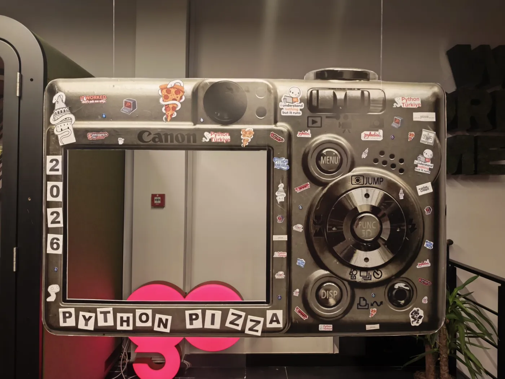
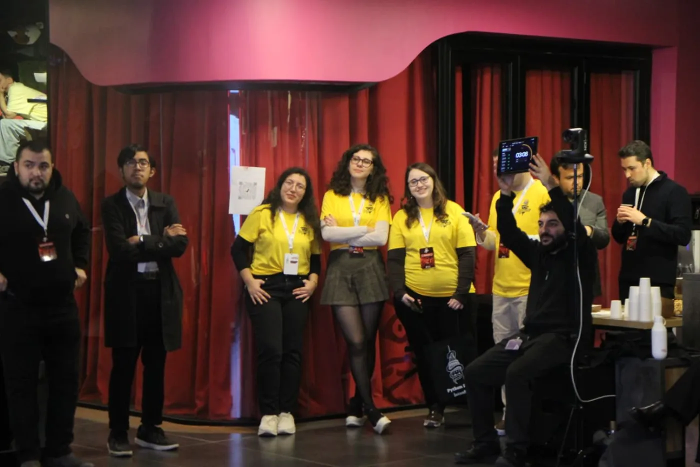
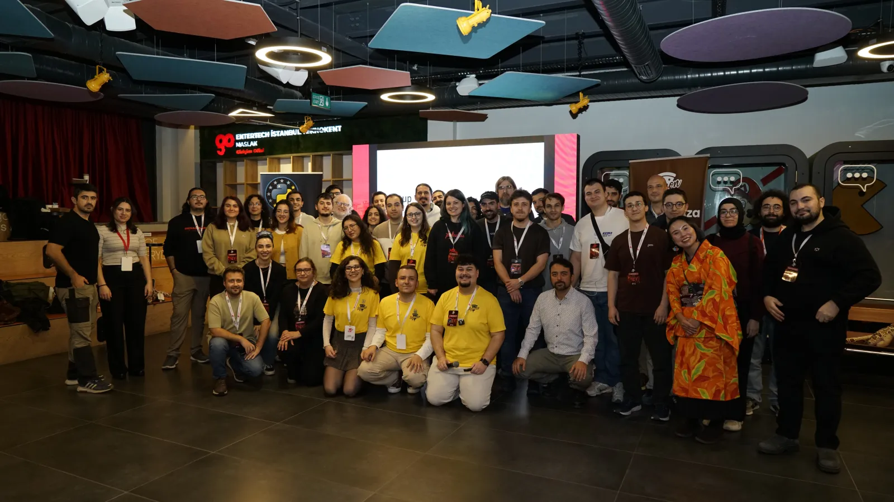

<figure class="captioned-figure">
  
</figure>

I've helped start a few communities. A GIS community at university, Python Ankara meetups, and Python Pizza İstanbul. I'd like to say I came up with something, but I didn't. Every one of them was an iteration of something I saw once, somewhere, and then paid forward.

This is the story of where I saw it, and who showed me.

## The curious bug

I've always been a curious bug, always wanted to learn new things, with a *thirst* for *knowledge*.

At university I attended programming events as a non-CS student and didn't understand a single thing about neo4j. But it was enough to spark a joy inside me. I wanted to do this, so I founded "Harita Yazılım ve Teknolojileri Topluluğu", a GIS development community. We gathered around and shared our limited knowledge with each other to grow.

I knew some Matlab for *some reason*, it was popular in academia, but Python stuck with me. Some even called me "the Python guy". I guess I talked about it nonstop.

The reason I wanted a community at all goes back to a kodla.co event, where I met Yiğit Güler. He was one of the speakers. I just stood there watching him and the others talk about the things they loved, and everybody around having fun. That was the moment I decided to organize something about GIS development, and the next year we invited him to "Haritayı Kodla", a day with speakers that we organized ourselves. It was a fun day.

<figure class="captioned-figure">
  
  <figcaption>Haritayı Kodla: Yiğit at the podium, me standing beside it in the black t-shirt.</figcaption>
</figure>

## The missing piece

After graduation I moved to Ankara, the capital. Covid happened, lots of things happened, and through all of it something was missing. I wanted to talk to people. Not just any people, but people who are at least as excited as I am about new things in technology, programming, or whatever they care for.

In 2021 I was already sketching a snake rolling around Atakule, the logo of a Python community that didn't exist yet. It took me four more years to find the courage to build it.

In April 2025 I started organizing Python Ankara events. The first one had about 8 people. A couple of friends and I have organized around 20 meetups since. We learned from each other, tried to teach others and made new friendships along the way. It was, and still is, my main motivation.

## Python Pizza İstanbul

I'd never had a chance to attend a PyCon, and I wanted one in Türkiye too.

So I reached out to some of the active community members I know. One thing led to another, and we had a meeting. And then we had our Python Pizza İstanbul event, on 14 November.

It was tiring. But the part I keep coming back to is simple: watching people meet each other. That's all a community is, and I got to stand at the back and see it happen. I miss it already.

And Yiğit was there. After nearly 8 years we met again. He sponsored us, he backed us, and he mentored us. He was the organizer of PyCon 2020 during covid, so he knew exactly what it takes to build something like this.

<figure class="captioned-figure">
  
  <figcaption>Yiğit and me at Python Pizza İstanbul.</figcaption>
</figure>

<figure class="captioned-figure">
  
  <figcaption>Me and the gang.</figcaption>
</figure>

<figure class="captioned-figure">
  
  <figcaption>The photo frame: my lovely wife's touch on the event.</figcaption>
</figure>

## Halil abi

While researching the revenue of the organization, we reached lots of places and lots of people. Some never wrote back. Some pointed us to others. Until we met Halil Karabulut from StartGate Tekmer.

I've never met anyone so selfless. He helped us with the venue, where he works. He helped us find coffee. He did whatever he could without asking anything back.

But there's one moment I'll remember. On the day of Python Pizza, nobody was handling the timer for the speakers. Nobody had even noticed. Halil abi did. He set it up himself and held it up in front of the speakers so they could see how much time they had left.

<figure class="captioned-figure">
  
  <figcaption>Halil abi, holding the timer up.</figcaption>
</figure>

His presence was the one easy thing when nothing else was. Teşekkürler Halil abi.

## Thank you

At some point there were up to 80 of us in that room. Speakers, volunteers, and everyone who came to sit in it. You are the reason it was a community and not just an event. Thank you for coming, and thank you for talking to each other.

<figure class="captioned-figure">
  
  <figcaption>Everyone who made it to the end.</figcaption>
</figure>

## Python is the glue

Lastly, Python is the glue of all of this. It was always more than a programming language to me. It brought me into a world I had no idea about. I make a living from it, and it taught me how people around the world contribute to each other.

So here is the whole lesson, as far as I have it. If you've been wishing for people who are as excited as you are, go to a meetup. If there isn't one near you, start it. You don't need to invent anything. Somebody showed you how, and one day somebody will say the same about you.
